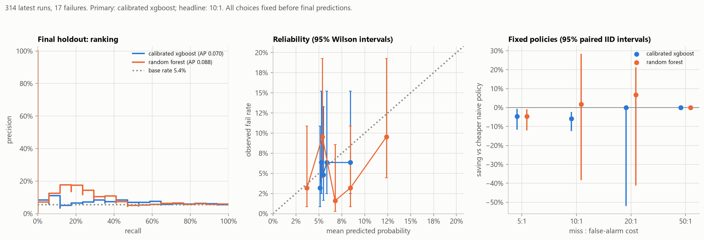
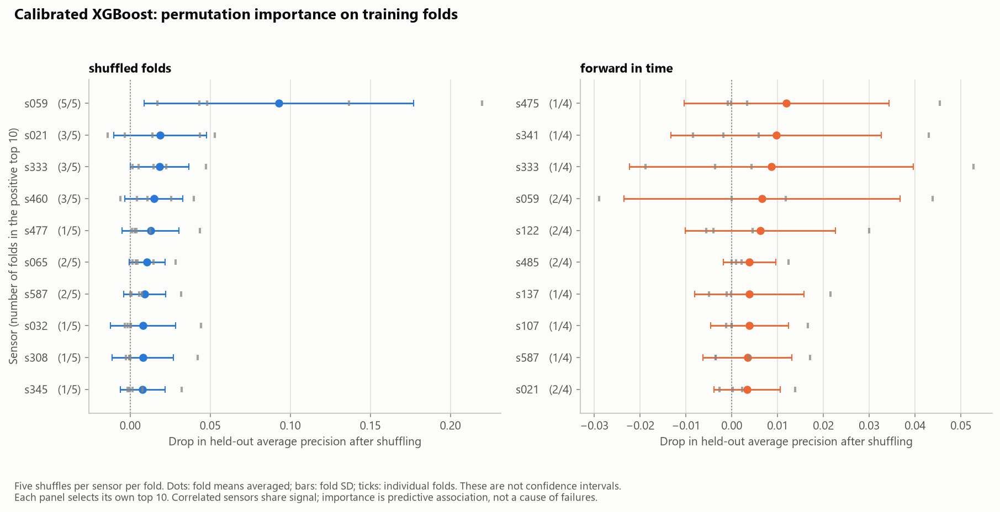

# SECOM: does failure prediction reduce inspection cost?

A reproducible study of the UCI SECOM semiconductor dataset: 1,567 production runs,
590 anonymous sensors, rare failures, missing readings, correlated signals, and temporal drift.
The objective is to test whether a probability-based alarm policy improves on simple decisions
under explicit error costs.

**Final result: the declared primary model did not reduce cost.** On the latest 314 runs
(17 failures), calibrated XGBoost cost **5.9% more than never alarming** at the predeclared
10:1 missed-failure/false-alarm cost ratio. It raised 10 false alarms and caught no failures.
The declared secondary random forest saved 1.8%, with a wide interval spanning losses and gains;
it was not promoted after seeing the test. Neither result justifies deployment.

## Final chronological holdout

The earliest 1,253 runs (87 failures) determine the models, sensor list, calibration, and
policy. The latest 314 runs are evaluated once after those choices are fixed.

| Model | Role | AP / PR AUC | ROC AUC | Brier score | Mean predicted failure rate |
|---|---|---:|---:|---:|---:|
| XGBoost + sigmoid calibration | Primary | 0.0704 | 0.5617 | 0.05187 | 6.0% |
| Random forest, uncalibrated | Secondary | 0.0880 | 0.5631 | 0.05221 | 7.3% |

The observed failure rate is 5.4%. A constant forecast using **training** prevalence has a
Brier score of 0.05144, slightly better than either model (lower is better). ROC AUC intervals
include 0.5. AP is average precision, rather than trapezoidal interpolation of the PR curve.

At the fixed **10:1** ratio, alarm when `p > 1/11`, or 9.09%:

| Model | Failures caught | False alarms | Missed failures | Cost / 1,000 runs | Saving vs best naive policy (95% paired IID interval) |
|---|---:|---:|---:|---:|---:|
| Calibrated XGBoost | 0 / 17 | 10 | 17 | 573.2 | −5.9% (−12.5% to −2.4%) |
| Random forest | 7 / 17 | 67 | 10 | 531.8 | +1.8% (−38.3% to +28.4%) |

Never alarming costs **541.4** per 1,000 runs; inspecting every run costs **945.9**.
The default 0.5 threshold raises no alarms for either model. Costs are in units of one
false-alarm inspection, not dollars. A predeclared 20-run circular-block bootstrap gives a
primary saving interval of **−13.7% to −3.1%** and a secondary interval of **−57.8% to +37.4%**.



All four cost ratios are reported, without choosing the best-looking one:

| Miss : false alarm | Formula threshold | Primary saving vs best naive | Secondary saving vs best naive |
|---|---:|---:|---:|
| 5:1 | 16.67% | −4.7% | −4.7% |
| **10:1 — headline** | **9.09%** | **−5.9%** | **+1.8%** |
| 20:1 | 4.76% | 0.0% | +6.7% |
| 50:1 | 1.96% | 0.0% | 0.0% |

At 20:1 and 50:1 the primary alarms on every run, adding no value over inspecting everything.
Full counts, baselines and intervals are in [the final report](results/final_test_report.md)
and [the cost table](results/final_test_costs.csv).

## Why the training results looked better

The training failure rate fell substantially over time, and sensors reveal the period.
Shuffling mixes those periods, giving a more favorable view than predicting subsequent runs.

| Evaluation view | Primary saving at 10:1 | Secondary saving at 10:1 |
|---|---:|---:|
| Shuffled training folds | +26.7% | +23.0% |
| Forward training folds | −36.3% | −51.7% |
| Final later holdout | −5.9% | +1.8% |

These are different populations and training-set sizes, not repeated estimates of exactly
the same quantity. Good-looking shuffled results did not establish a useful future alarm policy.

## Methods and decisions fixed before final predictions

- **Cleaning:** drop sensors with more than 50% missing values or at most one observed value,
  using training runs only. This keeps 444 sensors. Median imputation is fitted within each
  model pipeline; only logistic regression is standardized. No missingness indicators.
- **Candidates:** regularized logistic regression, random forest, gradient boosting,
  isolation forest, and XGBoost. XGBoost was added after the first four were evaluated;
  its settings were fixed before its scores were examined. No hyperparameter search,
  class weighting, SMOTE, or early stopping.
- **Selection:** highest mean shuffled-fold average precision selected XGBoost (0.238 vs
  random forest's 0.223). That small gap does not establish superiority. Random forest
  was retained as a declared secondary; both are reported regardless of their results.
- **Calibration:** the primary uses a sigmoid fitted to inner cross-validated training scores,
  followed by refitting the base model on all available fitting rows (`ensemble=False`).
  Uncalibrated XGBoost underestimated training failure probabilities. An earlier rule to
  retain calibration only when Brier improves was openly overridden on training reliability
  evidence: calibrated Brier was slightly worse (0.0632 vs 0.0629). This is a documented
  development decision. The forest remains uncalibrated.
- **Policy:** a false alarm costs 1, a missed failure costs 5, 10, 20, or 50, and correct
  decisions cost zero. Comparing `(1-p) * C_FA` with `p * C_miss` gives
  `p > C_FA / (C_FA + C_miss)`. The headline is the primary at 10:1, against the cheaper of
  never alarming and inspecting all runs. No drift correction or test threshold search.
- **Interpretation:** permutation importance uses the primary model on held-out training
  folds, with five shuffles per sensor, in both shuffled and forward views. The imputer
  and calibrator are fitted on each fold's fitting rows. These results do not select sensors
  or change the final model. Importance is association, not causation.

## Sensor importance and stability

Sensor **s059** appears in the positive top ten in all five shuffled folds, but only two
of four forward folds. Every pair of forward top-ten lists shares just one sensor. The
leading forward sensor, s475, has positive importance in only two of four folds and a
near-duplicate (s203, absolute correlation 0.998). This does not support a stable causal
sensor ranking. No features were selected or models changed using these diagnostics.



Bars show fold standard deviations, not confidence intervals; ticks show individual folds.

## Reproduce and inspect

Python 3.12 and the exact package versions in `requirements.txt` produced these results.
From PowerShell in this project:

```powershell
py -3.12 -m venv .venv
.\.venv\Scripts\Activate.ps1
python -m pip install -r requirements.txt
python -m pip install -e ".[dev]"
python -m pytest -q
```

Training analyses (the first data-loading command downloads the raw UCI files if absent):

```powershell
python -m secom_ml.explore
python -m secom_ml.prepare
python -m secom_ml.compare_models
python -m secom_ml.check_drift
python -m secom_ml.calibrate
python -m secom_ml.cost_policy
python -m secom_ml.importance
```

The final evaluation has already been completed in this checkout. Rebuild its tables and
figure using saved probabilities, with no raw-data read or model refit:

```powershell
python -m secom_ml.final_test --report-only
```

The initial command is `python -m secom_ml.final_test`. It refuses to evaluate again when its
manifest or predictions exist. Do not remove that guard to tune against this holdout;
new modeling decisions need a new future evaluation period. An interrupted evaluation also
leaves its manifest for inspection rather than silently repeating the experiment.

## Outputs

| Artifact | Contents |
|---|---|
| [Final report](results/final_test_report.md) | Both models, all cost ratios, uncertainty and limitations |
| [Final metrics](results/final_test_metrics.csv) | AP, ROC AUC, Brier, prevalence and interval estimates |
| [Final cost policies](results/final_test_costs.csv) | Counts, costs, savings, IID and block intervals |
| [Final predictions](results/final_test_predictions.csv) | Saved probabilities and outcomes for every test run/model |
| [Frozen manifest](results/final_test_manifest.json) | Choices, sensor list, source hashes, versions, dates and prediction checksum |
| [Training cost policies](results/cost_policy_training.csv) | Shuffled and forward development results |
| [Importance summary](results/importance_summary.csv) | AP drops, positive/top-10 fold counts and correlated-sensor context |
| [Fold stability](results/importance_pairwise_stability.csv) | Pairwise rank correlation and top-10 overlap |

Raw data and private interview notes are git-ignored. Scripts and CSVs are the reproducible
project; private interview answers are in `interview_prep.md` locally.

## What this would be worth in production

The model is not the useful output. The evaluation process is: it would have stopped this
alarm from being deployed.

- **A release gate that caught a bad model.** Shuffled cross-validation showed a 26.7% saving.
  A team that shipped on that number would have paid 5.9% more than doing nothing, while
  catching no failures. The forward-in-time check predicted the direction of that failure
  (−36.3%) from training data alone, before the holdout was opened.
- **Baselines that keep the claim honest.** Pricing every policy against both "never alarm"
  and "inspect every run" shows when a model has quietly turned into a blanket rule. At 50:1
  on the training folds the policy looks 73% cheaper than never alarming and adds nothing over
  inspecting everything.
- **Drift checks that are cheap to run.** A date-only reference model and an "early or late
  run?" classifier (ROC AUC 0.998) showed that sensors reveal the period, which is why shuffled
  scores were inflated. The same checks work as routine monitors.
- **Calibration as a monitored quantity.** Predicted against actual fail rate by time block is
  a control chart for the model itself, and the trigger for retraining.
- **A holdout that cannot be reused by accident.** One script may load it, a test enforces
  that, and a manifest refuses a second evaluation.

## Limits and what would come next

Only 17 failures occur in the final period. The 2,000-resample intervals condition on these
observations and fixed fitted models; they omit retraining and model-selection uncertainty.
An empirical bootstrap cannot invent successfully caught failures when none were observed,
so the primary's negative saving interval is not proof that its future recall must be zero.
IID intervals assume independent runs. The 20-run circular-block check allows local dependence
but assumes a block length and joins the end of the period to its beginning; neither method
protects against a new process regime.

The cheaper naive baseline uses observed evaluation prevalence and is recomputed in each
resample. It is a strong retrospective comparator, not advance knowledge that an operator
would have. SECOM supplies no measured costs, capacity constraints, sensor meanings, or
evidence that an alarm prevents a defect; the cost model is a scenario analysis.

The fixed sensor list uses all training covariates, including validation-fold covariates.
Earlier cross-validation is therefore not fully isolated even though labels are excluded
from sensor selection. The final holdout is excluded from every fit and sensor decision.
Existing loaders parse complete raw files before returning the training slice, and earlier
phases reported aggregate test counts. The precise claim is that **test predictions were first
evaluated in Phase 6**, not that nobody had read any test-period bytes or counts.

Near-duplicate sensors can share or mask permutation importance; shuffling can create
unrealistic sensor combinations. Fold rankings are descriptive, not causal attribution or
independent statistical replications. A useful next study would gather more failures, tool/chamber
and recipe context, maintenance history, and actual inspection/defect costs; put sensor selection
inside each fold; and evaluate a frozen revised policy on a new later period.

Dataset: [UCI SECOM](https://archive.ics.uci.edu/dataset/179/secom).
